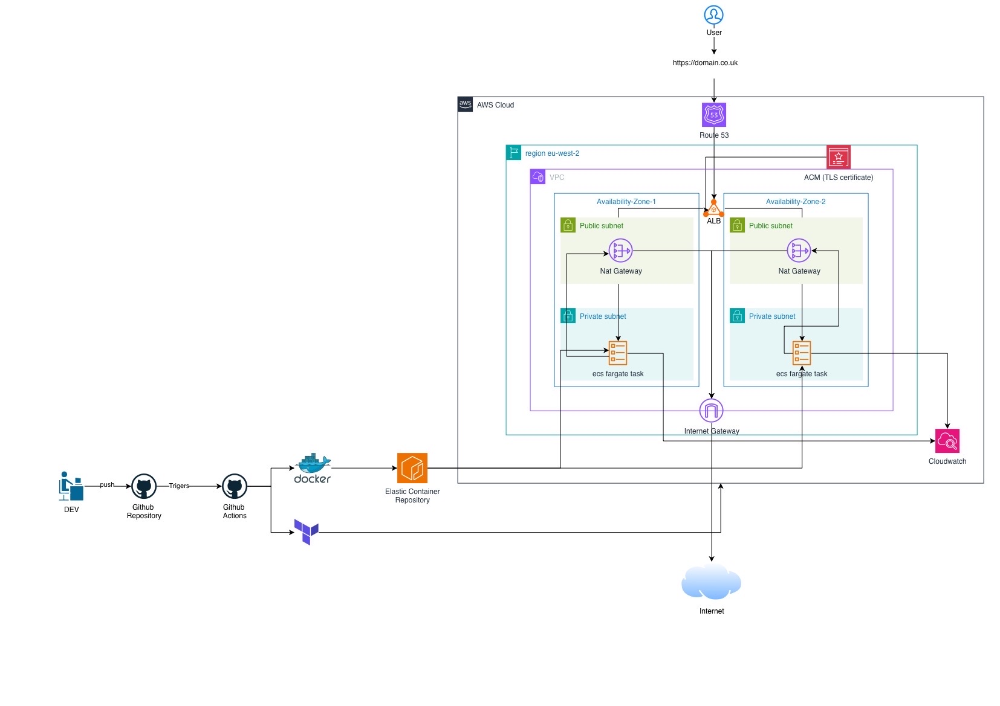

# Gatus Monitoring Platform on AWS ECS Fargate

> **Project status: In progress.** Local Gatus and Docker testing, basic GitHub Actions CI, and Terraform configuration validation are complete. AWS infrastructure deployment and automated continuous deployment (CD) are not yet complete.

## Project Overview

This project builds a containerised [Gatus](https://github.com/TwiN/gatus) monitoring platform using Docker, Amazon ECR, Amazon ECS Fargate, Terraform, GitHub Actions, and GitHub OpenID Connect (OIDC).

The goal is to deploy a monitoring dashboard on AWS with private application networking, a public Application Load Balancer (ALB), infrastructure as code, and an automated CI/CD pipeline. A custom domain and HTTPS will be added when a domain is available.

Development is staged so that the application is tested locally before AWS resources are created.

## Technology Stack

| Technology | Purpose |
| --- | --- |
| Gatus | Monitoring application and dashboard |
| Docker | Builds and runs the application container |
| Amazon ECR | Stores Docker images |
| Amazon ECS Fargate | Runs the application without managing servers |
| Application Load Balancer | Routes web traffic to the ECS service |
| Amazon VPC | Isolates public and private network resources |
| Amazon Route 53 | DNS for a future custom domain |
| AWS Certificate Manager (ACM) | TLS certificate for future HTTPS access |
| Terraform | Defines AWS infrastructure as code |
| GitHub Actions | Builds Docker images and, later, automates deployment |
| GitHub OIDC and AWS IAM | Planned short-lived, keyless AWS authentication |
| Amazon CloudWatch | Stores ECS application logs |

## Architecture

The **planned** AWS architecture includes:

- One VPC spanning two Availability Zones in `eu-west-2` (London).
- Two public subnets for an internet-facing ALB and NAT gateways.
- Two private subnets for ECS Fargate tasks.
- ECR for storing versioned container images.
- CloudWatch for container logs.
- GitHub Actions and OIDC for authenticated build-and-deploy workflows.
- Optional Route 53 DNS and ACM certificates when a domain is configured.



The diagram represents the target architecture, **not an already-running AWS deployment**. The initial ECS service is configured for one task; running across multiple Availability Zones alone does not make that service highly available.

## Repository Structure

```text
gatus-monitoring/
├── .github/
│   └── workflows/
│       └── docker-build-push.yml
├── assets/
│   ├── architecture.jpg
│   └── [project screenshots]
├── infra/
│   ├── provider.tf
│   ├── variables.tf
│   ├── main.tf
│   ├── vpc.tf
│   ├── security-groups.tf
│   ├── ecr.tf
│   ├── iam.tf
│   ├── alb.tf
│   ├── ecs.tf
│   ├── oidc.tf
│   ├── acm.tf
│   ├── route53.tf
│   └── outputs.tf
├── .gitignore
├── Dockerfile
├── config.yaml
└── README.md
```

The Terraform files are organised by responsibility, but Terraform reads all `.tf` files inside `infra/` as a single configuration.

## Gatus Configuration

The initial `config.yaml` checks Google every 30 seconds and treats HTTP status `200` as healthy:

```yaml
endpoints:
  - name: Google
    url: "https://www.google.com"
    interval: 30s
    conditions:
      - "[STATUS] == 200"
```

Gatus serves its dashboard on port `8080`. Its application health endpoint is `/health`.

## Run Gatus Locally

### Prerequisites

- Docker Desktop (or another working Docker engine)
- Git and a terminal

Clone the repository:

```bash
git clone https://github.com/01ENGINEER/gatus-monitoring.git
cd gatus-monitoring
```

Build the custom Docker image:

```bash
docker build -t gatus-monitoring:test .
```

Start the container:

```bash
docker run -d --name gatus-test -p 8080:8080 gatus-monitoring:test
```

Open the dashboard at **http://localhost:8080**.

Verify the application health endpoint:

```bash
curl -i http://localhost:8080/health
```

**Verified local result:** `HTTP/1.1 200 OK` with response body `{"status":"UP"}`.

To stop and remove the test container:

```bash
docker stop gatus-test
docker rm gatus-test
```

## Continuous Integration (CI)

The workflow in `.github/workflows/docker-build-push.yml` runs on relevant pushes to `main` and supports manual execution through GitHub Actions.

The current workflow:

1. Checks out the repository.
2. Sets up Docker Buildx.
3. Builds the Gatus Docker image using GitHub-hosted runners.
4. Defines a separate ECR push job, which is skipped until the AWS role is configured.

**Verified result:** The initial GitHub Actions workflow completed successfully with a green status. This verifies the automated Docker **build**; it does not yet prove an image was pushed to ECR or deployed to ECS. Runtime `/health` testing has been verified separately on the local machine, not yet as an automated CI test.

## Terraform Infrastructure as Code

The `infra/` directory contains 13 Terraform files:

| File | Responsibility |
| --- | --- |
| `provider.tf` | Terraform version and AWS provider |
| `variables.tf` | Region, project settings, image tag and optional domain |
| `main.tf` | Shared resource naming and tags |
| `vpc.tf` | VPC, subnets, internet gateway, NAT gateways and routes |
| `security-groups.tf` | ALB and ECS network access rules |
| `ecr.tf` | ECR repository and image lifecycle policy |
| `iam.tf` | ECS task and execution roles |
| `alb.tf` | Public ALB, target group and HTTP listener |
| `ecs.tf` | ECS cluster, task definition, service and CloudWatch logs |
| `oidc.tf` | GitHub OIDC provider and IAM roles |
| `acm.tf` | Optional ACM certificate request |
| `route53.tf` | Optional DNS and certificate validation records |
| `outputs.tf` | Useful infrastructure addresses and identifiers |

### Local Terraform Validation

Terraform was initialised and validated locally using:

```bash
terraform -chdir=infra fmt
terraform -chdir=infra init -backend=false
terraform -chdir=infra validate
```

**Verified result:** `Success! The configuration is valid.`

This confirms Terraform configuration validity, **not** successful creation of AWS resources. AWS credentials, cost review, deployment sequencing, state management, and integration testing are still required.

### Domain and HTTPS

A domain is **not required for initial infrastructure testing**. The initial plan uses the AWS-generated ALB hostname over HTTP. The optional `domain_name` and `route53_zone_id` settings will be used when a domain is available.

The final HTTPS listener and end-to-end certificate setup still need to be completed and tested. Do not treat HTTPS as deployed yet.

## Security Considerations

The project is designed around these controls:

- A non-root application user in the custom Docker image.
- ECS tasks in private subnets with no public IP addresses.
- Security groups permitting application ingress to ECS only from the ALB.
- IAM execution and application task roles with separate responsibilities.
- An ECR repository with encrypted image storage and immutable tags.
- GitHub OIDC trust restricted to the repository's `main` branch.
- A separate ECR push role and Terraform deployment role.

These are **implemented in local code or planned configuration**. They must be checked in AWS after deployment. The Terraform deployment role still requires an appropriately scoped permissions policy before it can deploy resources.

## Continuous Deployment (CD) — Planned

The remaining deployment workflow is intended to:

1. Establish AWS access and bootstrap the GitHub OIDC roles.
2. Create or import the ECR repository, as appropriate.
3. Build and push a Docker image tagged with the Git commit SHA.
4. Deploy the ECS service using an image tag that exists in ECR.
5. Run Terraform checks and apply approved infrastructure changes.
6. Verify the public ALB endpoint and `/health` response.
7. Add Route 53 and ACM-based HTTPS when a domain is available.

**CD is not yet operational.** The current Terraform code and GitHub Actions configuration are preparation for this stage.

## Progress Checklist

### Completed

- [x] Designed the target AWS architecture.
- [x] Created `config.yaml` and tested Gatus locally.
- [x] Created and successfully built the custom Docker image.
- [x] Verified the running custom container returns `HTTP 200 OK` at `/health`.
- [x] Created the GitHub repository and pushed project files.
- [x] Created a GitHub Actions workflow and verified a successful Docker build.
- [x] Written all 13 Terraform configuration files.
- [x] Completed local Terraform initialisation and validation.

### Remaining

- [ ] Review AWS costs and deployment readiness, especially NAT gateway charges.
- [ ] Check for existing AWS resources and import them into Terraform state if necessary.
- [ ] Configure AWS credentials and a safe Terraform state backend.
- [ ] Bootstrap GitHub OIDC and complete deployment-role permissions.
- [ ] Create or reuse ECR and push a versioned Docker image.
- [ ] Deploy ECS Fargate, ALB and related infrastructure.
- [ ] Confirm the ECS service and ALB target group are healthy.
- [ ] Verify the deployed Gatus dashboard and `/health` endpoint.
- [ ] Complete and test GitHub Actions automated CD.
- [ ] Configure a domain, ACM validation and HTTPS when available.
- [ ] Document deployment, screenshots and Terraform teardown.

## Project Evidence

Screenshots of important milestones are stored directly in [`assets/`](assets/), alongside the architecture diagram. Evidence includes successful GitHub Actions builds, Terraform validation and the local Docker health check. AWS deployment screenshots will be added after those resources are created.

## Cost and Cleanup Notice

AWS services used in the planned architecture, particularly **NAT gateways, the Application Load Balancer and ECS Fargate**, can incur charges while running. Review estimated costs before deployment and destroy temporary resources when testing is finished. Terraform resources must be managed through the correct state to avoid leaving billable infrastructure behind.

---

**Current status:** Local Gatus, Docker health verification, basic CI and Terraform validation are complete. AWS deployment, OIDC integration, full CD and HTTPS remain in progress.
